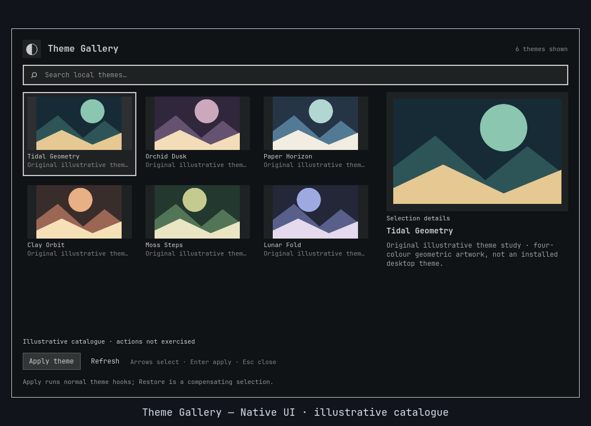

<div align="center">

# Theme Gallery

**Find the right atmosphere. Save the combination. Apply it deliberately.**

[](https://github.com/Battlelamb/omarchy-theme-gallery/actions/workflows/ci.yml)

[Install](#install) · [Explore](#explore-your-themes) · [Save a combination](#save-a-theme--wallpaper-combination) · [Configure](#configure) · [Restore](#what-restore-can-and-cannot-do)

</div>

Browse installed themes with local image previews and real color swatches, then keep a favorite theme and wallpaper together as a named combination. Theme changes run Omarchy's normal hooks, rather than quietly editing configuration behind its back.

> [!IMPORTANT]
> **0.3.0 is a development/testing source snapshot, not a stable release.** It has been installed and opened on the maintainer's desktop for hands-on testing. Live Apply/Restore and the full nested old/new/rollback sequence are not qualified for this version.


*Historical 0.2.1 native Qt/Quickshell capture from an isolated headless compositor. The catalogue and original geometric art are illustrative, not bundled installable themes. Actions were not exercised; this is not 0.3.0 integration proof. [Preview provenance](docs/PREVIEW.md).*

## Install

Requires **Omarchy Quattro's native shell**, Python **3.11+**, and the installed Omarchy theme/background setters. No sibling plugin or shared framework is required. Plugins execute as your user inside the shell, so review the source before enabling one.

```sh
omarchy plugin add https://github.com/Battlelamb/omarchy-theme-gallery.git --enable
omarchy-shell shell summon leviathan.theme-gallery
```

The Git install follows repository source, not a stable release tag. It does not install themes, wallpapers or fonts.

<details>
<summary>Optional: Super+Space → Appearance → Theme Gallery</summary>

Back up `~/.config/omarchy/extensions/omarchy-menu.jsonc`, then merge this entry into its existing menu object (or its `items` object, if used). Preserve the other entries. Create the file only if it does not exist; do not replace an existing menu with this snippet.

```jsonc
{
  "appearance.theme-gallery": {
    "label": "Theme Gallery",
    "action": "omarchy-shell shell summon leviathan.theme-gallery"
  }
}
```

This optional shortcut is not installed automatically. The summon command works independently.

</details>

## Explore your themes

| You want to… | Control | What happens |
| --- | --- | --- |
| Find a theme | Type in the panel | Filters the current catalogue. |
| Inspect without changing anything | Click a tile; arrows; Home / End | Selects a result and shows its local preview and swatches. |
| Change the desktop theme | **Enter / Apply theme** | Runs normal Omarchy theme hooks and checks their result. |
| Keep a favorite close | **More → Favorite** | Saves a local favorite; use the Favorites view to find it. |
| Revisit a successful selection | **Recent** view | Lists confirmed Apply operations, not every click. |
| Reread installed files | **Refresh** | Rebuilds the catalogue. |
| Leave the panel | **Esc** or click outside | Esc leaves Configure first; closing does not undo an accepted action. |

Swatches come from installed `colors.toml` files, with valid user-overlay colors taking precedence. Light/dark classification uses the background color's relative luminance. An absent or invalid background stays **unknown**, visible under All rather than guessed.

Your catalogue reflects your installed stock/user themes. There is no fixed theme count and no downloadable theme pack in this repository. Wide layouts show a side preview; compact layouts use the scrolling detail area.

## Save a theme + wallpaper combination

1. Select an **installed theme** tile.
2. Open **More**, enter a unique **Capture name** of up to 64 characters, then choose **capture**.
3. Find the saved combination as its own tile. **Apply theme** runs the theme hooks first, then explicitly sets the combination's frozen wallpaper bytes.

Capture saves the selected theme with the **current wallpaper**, without applying either. The image must be in a supported safe local root, or be this plugin's own hash-verified snapshot. An optional `wallpaper` path can select another local image through the action data/CLI contract in [BACKEND.md](BACKEND.md); nothing is downloaded.

Saved combinations are reserved three-item collection records, not ordinary editable lists. To remove one, enter its name under **More → Collection name → Delete collection**. Do not use **Add/remove item** to edit a combination. Changed source-image bytes require a new capture; saved image paths are limited to 251 characters.

## Configure

Open **Configure**, adjust the options, then choose **Save settings**.

| Setting | Default | Choices |
| --- | --- | --- |
| Light / dark filter | All | All, light, dark; unknown is included only in All. |
| Favorites only | Off | Restrict the backend catalogue to saved favorites. |

Preferences are stored outside the plugin checkout:

```text
$XDG_CONFIG_HOME/omarchy/lego/theme-gallery/preferences.json
# Fallback when XDG_CONFIG_HOME is not absolute:
$HOME/.config/omarchy/lego/theme-gallery/preferences.json
```

**Reset preferences** clears options, favorites, recent items and saved combinations. It does **not** restore the desktop or erase recovery receipts/snapshots. Unsafe or corrupt files are refused rather than silently replaced.

## What Restore can and cannot do

**Restore is a one-level compensating selection, not a complete rollback.** It reruns the previous installed theme through normal hooks. For an applied combination it also restores a verified snapshot of the previous wallpaper. Application retints and other hook side effects are not universally reversible.

Restore refuses a changed theme generation, an edited snapshot, or an unrelated external wallpaper selection. Warnings, missing acknowledgements and partial operations remain failures even when the theme name changed. Restore itself can fail partially; refresh and inspect the error instead of assuming the desktop returned to its former state. Closing, disabling or removing the plugin is not an automatic undo.

Combination snapshots live under `$HOME/.local/state/omarchy-theme-gallery/`, limited to **16 files / 256 MiB**, with **32 MiB per image**. They are not automatically pruned. Preserve snapshots in use by the active desktop or Restore receipt.

### Local-only boundaries

- Supported combination images come from `~/Pictures/Wallpapers`, Omarchy user backgrounds and one collection level, installed-theme backgrounds, or staged current-theme backgrounds. Only this plugin's verified snapshots are additionally admitted, not another plugin's state directory.
- Symlinked files/ancestors, traversal, special files and over-budget sources are refused. The known Omarchy current-background link is read only through separate target validation.
- At most **256 filtered tiles** are displayed. Actions recheck fresh installed membership, not just the visible subset. No image or font library is bundled.

<details>
<summary>Verification and troubleshooting</summary>

The recorded frozen 0.3.0 offline gate passed **71 Python tests** with **1 explicit skip**, plus **51 Node component tests**. Native component fixtures and package checks are separate overlapping coverage, not a live action result. See [validation history](docs/VALIDATION.md) and [CI scope](docs/CI.md). The badge above reports GitHub's actual workflow state; it is not a static pass claim.

The current testing deployment has been opened/captured/closed with real catalogue data. That does not qualify live Apply/Restore, long-soak behavior or the full nested upgrade/rollback gate. Earlier validation notes retain their historical deployment status; the source snapshot remains unqualified for stable release.

To rerun the shipped offline backend checks from a checkout, first set `TMPDIR` to an existing private scratch directory. The runner requires its offline bwrap prerequisites:

```sh
env -u PYTHONPATH /usr/bin/python3 scripts/run-tests.py --backend-only
```

The runner uses a cleared fake HOME, no network/live compositor sockets and fixture setters. It does not prove application-hook completeness or displayed pixels.

| Symptom | Check |
| --- | --- |
| A theme is missing | Clear search, view and Configure filters; Refresh. Check that the theme is safely installed. |
| Capture is refused | Select an installed theme, use a new name, check the current image's safe-root membership and snapshot quota. |
| Restore is refused | An external change or changed snapshot may have invalidated ownership. Do not bypass the conflict check. |
| A preference warning follows Apply | The confirmed theme action is not undone by a later Recent-save or optional snapshot warning. |

New preference writes share an aggregate **128 KiB** budget. Larger valid legacy stores remain bounded/readable for explicit Reset/recovery; this does not promise every list's maximum can be used simultaneously. [Exact CLI, limits and recovery contract](BACKEND.md).

</details>

<details>
<summary>Disable or remove</summary>

Use Restore first if you want the available compensation.

```sh
omarchy-shell shell hide leviathan.theme-gallery
omarchy plugin disable leviathan.theme-gallery
# Optional:
omarchy plugin remove leviathan.theme-gallery
```

Removal is not desktop restoration or cleanup of preferences and recovery data.

</details>

---

**GPL-3.0-only** · [License](LICENSE) · [Source notices](NOTICE.md) · [Backend attribution](NOTICE.backend.md) · [Contributing](CONTRIBUTING.md) · [Security](SECURITY.md)

Independent community plugin by Ömer Eren. Not an official Omarchy or HyDE release.
