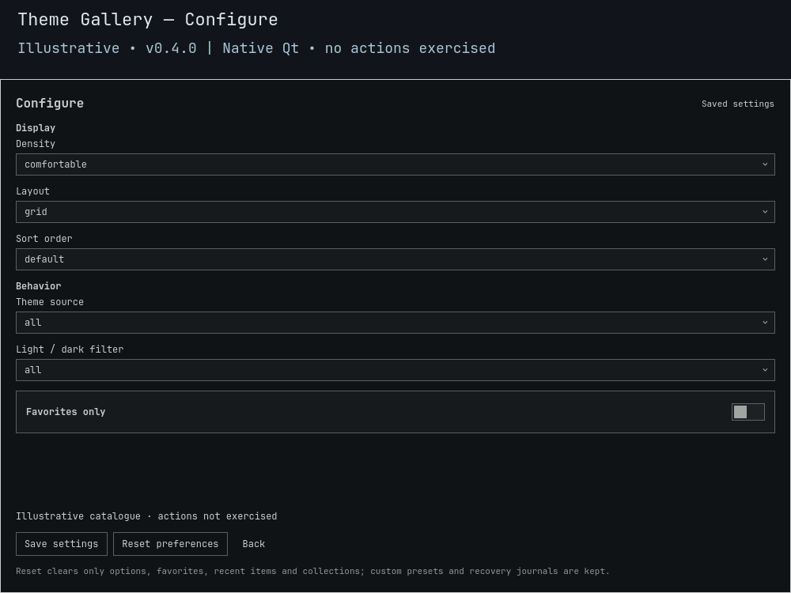

# Theme Gallery

**Find a theme, keep its wallpaper pairing, apply it deliberately.**

Browse installed themes with local previews and real color swatches. Narrow the gallery to user or stock sources, save favorites, and capture a named theme–wallpaper combination without changing the desktop.

> **0.4.1 development candidate — not a stable release or installed upgrade.** Backend behavior is checked offline with fixture providers. Native UI integration, live Apply/Restore and the full nested upgrade/rollback gate require separate qualification.


*Illustrative **0.4.0** native Qt component render with fictional/original example data. No installed library, desktop action or full-shell behavior is demonstrated. [Preview provenance](docs/PREVIEW.md).*

<details>
<summary>Preview native saved settings</summary>



*Illustrative Configure view; fields may scroll. The capture does not exercise Save or Reset.*

</details>

## Install and open

Requires **Omarchy Quattro's native shell**, **Python 3.11+**, and Omarchy's installed theme/background setters. Each plugin works independently. Shell plugins run as your user; review the source before enabling.

```sh
omarchy plugin add https://github.com/Battlelamb/omarchy-theme-gallery.git --enable
omarchy-shell shell summon battlelamb.theme-gallery
```

Git installation follows the repository source, not an unreleased candidate or stable tag. No themes, wallpapers or fonts are installed. The summon command works independently of any menu entry or dedicated hotkey.

**Namespace migration:** existing installation, enabled-plugin, menu and binding references need updating to `battlelamb.theme-gallery`. Preferences and recovery data stay at their stable paths; a normal source update does not rename plugin IDs automatically.

## Explore and choose

| Control | Result |
| --- | --- |
| Type to search | Narrow the current catalogue. |
| Click a tile; arrows; Home / End | Select a theme and inspect its preview/swatches; nothing is applied. |
| **Enter / Apply theme** | Run the normal Omarchy theme hooks, then check their result. |
| **More → Favorite** | Toggle a saved favorite. Favorites/Recent views help revisit selections. |
| **Refresh** | Reread installed sources. |
| **Esc** / click outside | Leave Configure first or dismiss the panel; accepted actions are not undone. |

Swatches come from `colors.toml`; valid user-overlay colors take precedence. Light/dark uses the background color's relative luminance, not a guessed theme name. Missing background colors remain **unknown**.

### Save a combination

Select an installed theme, enter a unique **Capture name** under **More**, then choose **capture**. Capture saves that theme with the current safe local wallpaper; it does not Apply. The saved combination gets its own tile. Applying it runs theme hooks first and then selects frozen wallpaper bytes.

An optional local `wallpaper` path is available through the [backend contract](BACKEND.md). Capture names are at most 64 characters; image paths at most 251. Changed image bytes require a new capture. Combinations are reserved records: delete one by name with **Delete collection**, not **Add/remove item**.

## Configure

Open **Configure**, change options, then **Save settings**.

| Setting | Default | Choices / behavior |
| --- | --- | --- |
| Theme source | All | All, user, stock. A stock theme with an admitted user overlay is **user**; its saved combinations follow the same source. |
| Light / dark filter | All | All, light, dark. Unknown appears only in All. |
| Favorites only | Off | Restrict results to saved favorites. |
| Density | Comfortable | Comfortable or compact. |
| Layout | Grid | Grid or list. |
| Sort order | Default | Default, name, favorites-first; ties retain their order. |

Source, appearance and favorite filters, then saved name/favorites-first ordering, run **before the 256-tile display cap** over the admitted bounded catalogue. Default keeps source order; name uses lowercase ordinal comparison and ties retain source order. Search and Favorites/Recent/collection views operate locally on those returned tiles, not the entire source set. Display options do not restrict fresh action membership or Restore authority.

Preferences survive source updates under `$XDG_CONFIG_HOME/omarchy/lego/theme-gallery/preferences.json`, falling back to `$HOME/.config/omarchy/lego/theme-gallery/preferences.json` when XDG is not absolute. **Reset preferences** clears options, favorites, recent items and combinations, not desktop state or recovery data. Corrupt/unsafe stores are refused rather than silently replaced.

## Apply safely; Restore honestly

**Restore is one-level compensation, not complete hook rollback.** It reapplies the previous installed theme through normal hooks; a combination also restores its verified previous-wallpaper snapshot. Application retints and arbitrary hook effects are not universally reversible.

Changed theme generation, unrelated wallpaper choices, edited snapshots or unconfirmed/warning-bearing providers refuse success. A partial operation or failed Restore can leave changed state: refresh and inspect the warning. Closing, disabling or removing the plugin never automatically restores the desktop.

- Only bounded installed stock/user themes and supported local image roots are admitted. Symlinked files/ancestors, traversal, special files and symlink-shadowed themes are excluded.
- Actions revalidate installed membership even when an item is filtered out or beyond the tile cap. No downloads, arbitrary commands or config-template execution.
- Combination snapshots: `$HOME/.local/state/omarchy-theme-gallery/`, **16 files / 256 MiB total**, **32 MiB per image**, no automatic pruning. Preserve active/Restore-owned snapshots.
- New preference saves share **128 KiB**; valid legacy stores are read up to **16 MiB** for Reset/recovery. Confirmed Apply stays successful if only a later Recent-save/optional snapshot fails, with a warning.

See [BACKEND.md](BACKEND.md) for exact CLI, safe roots, bounded source signatures and recovery rules.

## Verify or troubleshoot

From a checkout, set `TMPDIR` to an existing private scratch directory, then run the shipped offline bwrap harness:

```sh
env -u PYTHONPATH /usr/bin/python3 scripts/run-tests.py --backend-only
```

It clears HOME/environment, masks production setters and excludes network/live desktop sockets. These checks are not native pixel, live-hook or deployment proof. [Validation history](docs/VALIDATION.md) describes earlier builds, not a new candidate pass.

Missing theme? Clear search/view/Configure filters, Refresh, then check safe installation and scan limits. Refused Restore? Check for external state changes; do not bypass ownership checks.

```sh
omarchy-shell shell hide battlelamb.theme-gallery
omarchy plugin disable battlelamb.theme-gallery
# Optional; does not remove preferences/snapshots or undo desktop changes:
omarchy plugin remove battlelamb.theme-gallery
```

**GPL-3.0-only** · [License](LICENSE) · [Source notices](NOTICE.md) · [Backend attribution](NOTICE.backend.md) · [Contributing](CONTRIBUTING.md) · [Security](SECURITY.md)

Independent community plugin by Battlelamb; not an official Omarchy or HyDE release.
